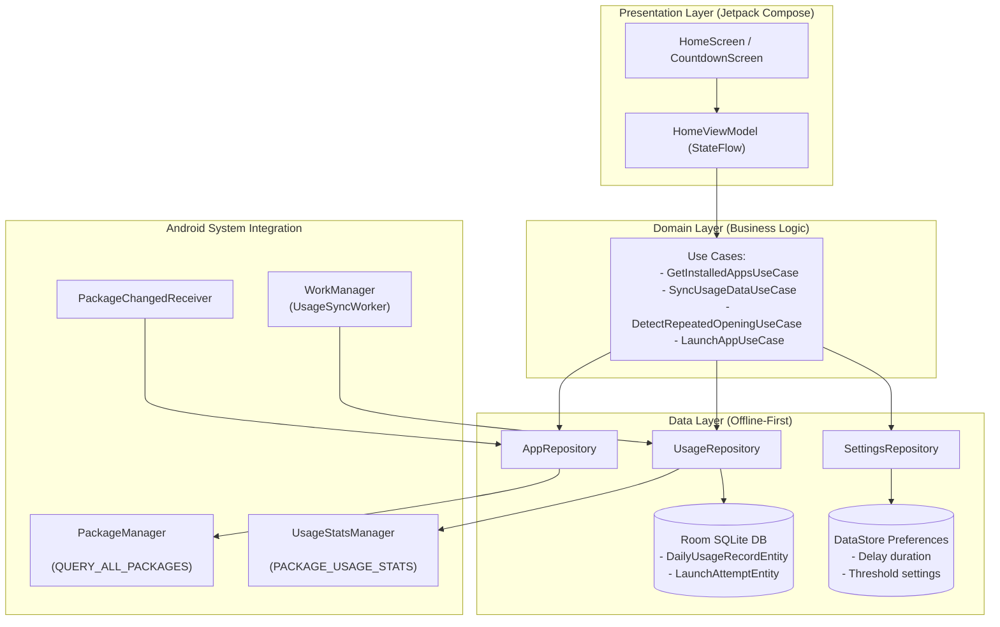

# Minima

[](https://github.com/fayaspsulfikkar/minima/actions/workflows/ci.yml)
[](https://kotlinlang.org)
[](https://developer.android.com)
[](https://developer.android.com/jetpack/compose)
[](#architecture)
[-success.svg)](#privacy--threat-model)
[](LICENSE)

An intentional, typography-driven Android launcher engineered to disrupt compulsive phone usage, habitual app re-opening, and doomscrolling loops through deliberate cognitive friction.

---

## The Philosophy of Cognitive Friction

Modern smartphone interfaces are deliberately engineered to minimize friction and trigger dopamine-driven habit loops: colorful high-contrast icons, unread notification badges, and instant tap-to-launch transitions.

Minima inverts these dynamics:

1. **Friction by Design (The Intentional Pause)**: Configurable delay timers (e.g., 5s, 10s, 15s) insert an intentional buffer between impulse and execution, transforming unconscious muscle memory into conscious choice.
2. **Repeated Open Interruption**: Automatically detects rapid re-opening of habit-forming apps within sliding temporal windows and presents a reflective reminder.
3. **Strict Monochrome Typography**: Eliminates visual triggers by stripping away colorful icons, badges, and animations. The interface is strictly `#000000` (pure black) and `#FFFFFF` (pure white).
4. **Non-Punitive Clarity**: Surfaces factual foreground screen-time data directly on the home screen without manipulative streaks, gamification, or guilt trips.

---

## System Architecture

Minima is architected following Clean Architecture principles and Unidirectional Data Flow (UDF), prioritizing testability, separation of concerns, and offline reliability.



---

## Technical Stack & Engineering Highlights

| Component | Technology | Rationale |
| :--- | :--- | :--- |
| **Language** | Kotlin 1.9.23 | Modern expressive syntax, coroutines, and null safety |
| **UI Framework** | Jetpack Compose BOM 2024.04.01 | Declarative UI, reactive state binding, pure black/white theming |
| **Architecture** | MVVM + Clean Architecture | Unidirectional data flow (UDF) with strict layer boundaries |
| **Dependency Injection** | Dagger Hilt 2.51.1 | Compile-time dependency resolution and scoped lifecycles |
| **Local Database** | Room 2.6.1 + KSP | SQLite persistence with indexed queries for usage records |
| **Reactive Settings** | DataStore Preferences 1.0.0 | Coroutine-first key-value storage replacing legacy SharedPreferences |
| **Background Sync** | WorkManager 2.9.0 | Battery-efficient periodic syncing of OS usage statistics |
| **Testing** | JUnit 4 + Coroutines Test | Comprehensive unit test suite covering use cases and view models |

---

## Privacy & Threat Model

Minima adheres to strict privacy-by-design standards:
- **Zero Network Footprint**: Minima does not declare `android.permission.INTERNET`. It cannot connect to remote servers or exfiltrate analytics.
- **Local Sandbox Storage**: All app usage calculations, launch records, and delay counters reside entirely on device in app-private SQLite databases.
- **No Third-Party Analytics**: No SDKs, trackers, or crash-reporting libraries that upload device telemetry.

---

## Getting Started

### Prerequisites
- JDK 17
- Android SDK 34 (Supported on Android 8.0 / API 26+)
- Android Studio Iguana (2023.2.1) or CLI

### Building from Source
```bash
# Clone the repository
git clone https://github.com/fayaspsulfikkar/minima.git
cd minima

# Run unit test suite
./gradlew testDebugUnitTest

# Run Android Lint
./gradlew lintDebug

# Build debug APK
./gradlew assembleDebug
```

### Installing and Granting Permissions via ADB
```bash
# Install the debug APK
adb install -r app/build/outputs/apk/debug/app-debug.apk

# Grant Usage Access permission via ADB (optional shortcut)
adb shell appops set com.minima android:get_usage_stats allow
```

---

## Project Structure

```
minima/
├── app/
│   ├── src/
│   │   ├── main/
│   │   │   ├── kotlin/com/minima/
│   │   │   │   ├── data/             # Room DB, DataStore, Repositories, System DataSources
│   │   │   │   ├── di/               # Hilt Dependency Injection modules
│   │   │   │   ├── domain/           # Pure Kotlin Use Cases, Models, and Repository interfaces
│   │   │   │   ├── receiver/         # Package change broadcast receivers
│   │   │   │   ├── ui/               # Jetpack Compose screens, theme, and HomeViewModel
│   │   │   │   └── worker/           # WorkManager background sync workers
│   │   │   └── AndroidManifest.xml
│   │   └── test/                     # Unit test suite for ViewModels and UseCases
│   └── build.gradle.kts
├── .github/
│   └── workflows/ci.yml              # GitHub Actions CI automation pipeline
├── ARCHITECTURE.md                   # In-depth architectural design specifications
├── CONTRIBUTING.md                   # Engineering standards and PR submission rules
├── CHANGELOG.md                      # Release notes and version history
└── LICENSE                           # Apache 2.0 License
```

---

## License

Copyright 2026 Fayas Sulfikkar. Licensed under the [Apache License, Version 2.0](LICENSE).
